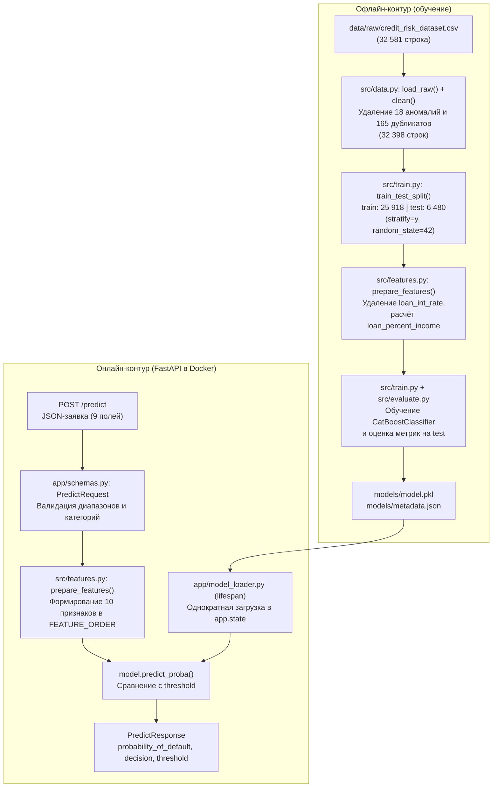

# Архитектура проекта (ARCHITECTURE)

## 1. Поток данных

Ниже представлена сквозная схема движения данных от сырого CSV-файла при офлайн-обучении до обработки HTTP-запроса в рантайме API:

---

## 2. Назначение каталогов

- `src/` — код офлайн-контура и общая логика признаков:
  - `src/data.py` — чтение сырого датасета и фильтрация аномалий и дубликатов;
  - `src/features.py` — константы признаков (`INPUT_FEATURES`, `DROP_COLS`, `CAT_FEATURES`, `FEATURE_ORDER`) и функция `prepare_features`;
  - `src/evaluate.py` — функции `compute_metrics` и `compute_threshold_metrics`;
  - `src/train.py` — скрипт полного цикла обучения и генерации артефактов.
- `models/` — версионируемые в git артефакты обученной модели (`model.pkl`) и её паспорта (`metadata.json`).
- `app/` — веб-сервис `FastAPI`, отвечающий только за загрузку готовых артефактов, валидацию входного JSON и выдачу предсказаний (`main.py`, `config.py`, `model_loader.py`, `schemas.py`, `routes/health.py`, `routes/predict.py`).
- `notebooks/` — исследовательские ноутбуки с обоснованием всех решений по очистке данных (`01_eda.ipynb`), линейному бейзлайну (`02_baseline.ipynb`) и основной модели (`03_main_model.ipynb`).
- `tests/` — модульные и интеграционные тесты (`test_model.py`, `test_api.py`).
- `data/` — локальное хранилище сырых (`data/raw/`) и очищенных (`data/processed/`) данных; исключено из git и Docker-образа.
- `docs/` — проектная документация (`SPEC.md`, `ARCHITECTURE.md`).

---

## 3. Единая подготовка признаков (`src/features.py`)

Функция `prepare_features(df)` вынесена в общий модуль `src/features.py` и импортируется как в `src/train.py` при обучении модели, так и в `app/routes/predict.py` при обработке каждого HTTP-запроса.

Такое разделение решает две архитектурные задачи:
1. **Исключение расхождения между обучением и инференсом (`training-serving skew`):** удаление столбца `loan_int_rate` (если он присутствует в датафрейме), вычисление производного признака `loan_percent_income = loan_amnt / person_income`, приведение категориальных колонок `CAT_FEATURES` к строковому типу и строгая фиксация порядка 10 столбцов (`FEATURE_ORDER`) выполняются одним и тем же кодом.
2. **Упрощение контракта API:** клиенту не требуется самостоятельно рассчитывать и передавать `loan_percent_income` (в исходном датасете этот столбец был округлён до двух знаков и в `388` строках расходился с отношением `loan_amnt / person_income`), что предотвращает подачу несогласованных значений на вход модели.

---

## 4. Управление порогом и конфигурацией

Базовый порог отсечения (`0.16`), полученный при минимизации средней стоимости ошибки (`c = 5`), записывается скриптом `src/train.py` в поле `"threshold"` файла `models/metadata.json`.

При инициализации настроек сервиса (`app/config.py`, класс `Settings` на базе `pydantic-settings`) действует следующий порядок приоритетов:
1. По умолчанию функция `_load_default_threshold()` считывает значение `"threshold"` из `models/metadata.json` (если файл недоступен, используется резервное значение `0.16`).
2. Если в окружении процесса или в файле `.env` задана переменная `THRESHOLD` (например, `THRESHOLD=0.24` для сценария `c = 3`), `pydantic-settings` автоматически переопределяет значение по умолчанию без изменения кода и без пересборки образа.
3. При старте `FastAPI` (`app/model_loader.py`) итоговое значение порога фиксируется в `app.state.threshold` и возвращается как в `GET /health`, так и в каждом ответе `POST /predict`.

Аналогичным образом через переменные `MODEL_PATH` и `METADATA_PATH` могут быть переопределены пути к файлам артефактов.

---

## 5. Сборка и устройство Docker-образа

Контейнер сервиса собирается по инструкции в `Dockerfile` на базе официального легковесного образа `python:3.12-slim`:
- **Кэширование слоя зависимостей:** сначала в рабочую директорию `/app` копируется только `requirements.txt` и выполняется `pip install --no-cache-dir -r requirements.txt`. Пакеты разработки из `requirements-dev.txt` (`jupyter`, `optuna`, `shap`, `matplotlib`, `pytest`) в образ не устанавливаются. При изменении кода в `app/` или `src/` слой зависимостей берётся из кэша Docker.
- **Минимальный состав образа:** в контейнер копируются только каталоги `app/`, `src/`, `models/` и файл `requirements.txt`. Сырые и обработанные данные (`data/`), ноутбуки (`notebooks/`), тесты (`tests/`), документация (`docs/`), виртуальное окружение (`.venv/`) и локальный `.env` исключены из контекста сборки через `.dockerignore`.
- **Непривилегированный пользователь:** в образе создаётся системный пользователь `appuser` (`useradd --create-home --shell /bin/bash appuser`), которому передаются права на скопированные файлы (`COPY --chown=appuser:appuser`), после чего процесс `uvicorn` запускается под директивой `USER appuser`.
- **Проверка состояния (`HEALTHCHECK`):** в `Dockerfile` и `docker-compose.yml` настроен встроенный `HEALTHCHECK` (интервал `15s`, таймаут `5s`, стартовый период `10s`, `3` попытки), который обращается к `http://127.0.0.1:8000/health` средствами стандартной библиотеки Python (`urllib.request`), не требуя установки `curl` или `wget` в образ.

---

## 6. Согласованность версий `CatBoost` и артефактов модели

Бинарное представление дерева в `models/model.pkl` (сериализованное через `joblib`) напрямую зависит от версии библиотеки `catboost`. Для предотвращения ошибок десериализации и смещения предсказаний версия пакета синхронизирована в трёх местах:
1. В `requirements.txt` жёстко зафиксирована версия `catboost==1.2.10`.
2. При выполнении `python -m src.train` фактическая версия библиотеки (`catboost.__version__`) сохраняется в `models/metadata.json` в блоке `"versions": {"catboost": "1.2.10", ...}`.
3. При старте сервиса `app/model_loader.py` считывает версию из `models/metadata.json` и публикует её в эндпоинте `GET /health` (`"catboost_version": "1.2.10"`), что позволяет контролировать соответствие загруженного артефакта и окружения контейнера.
